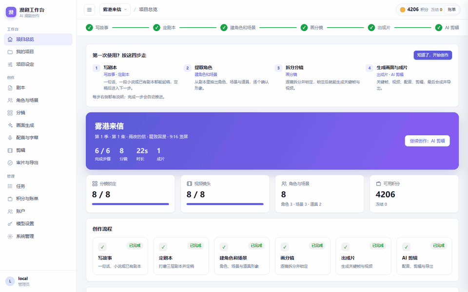
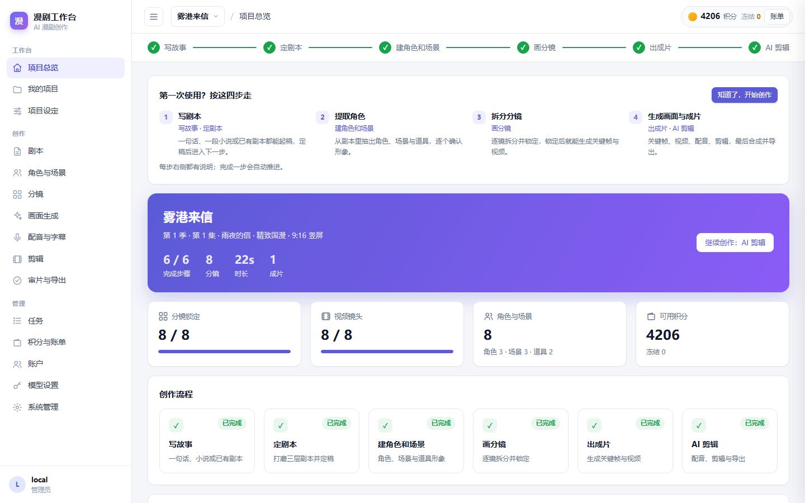
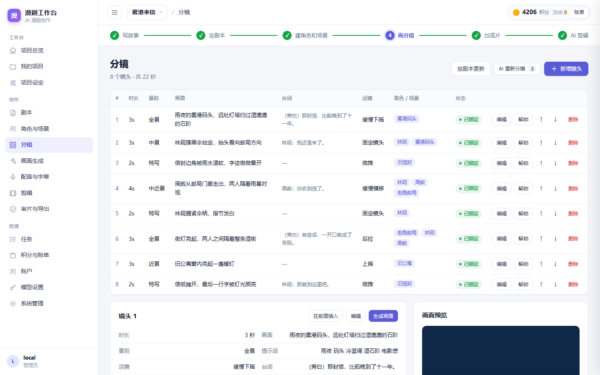
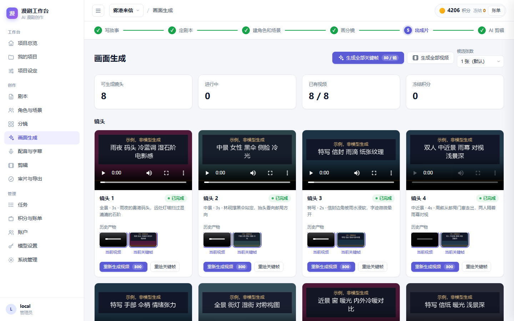
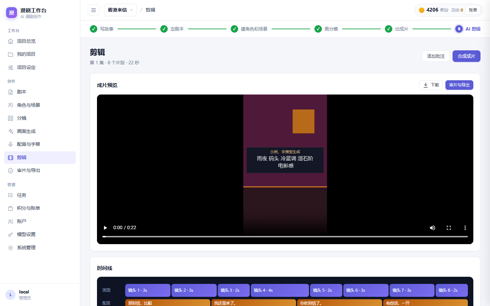
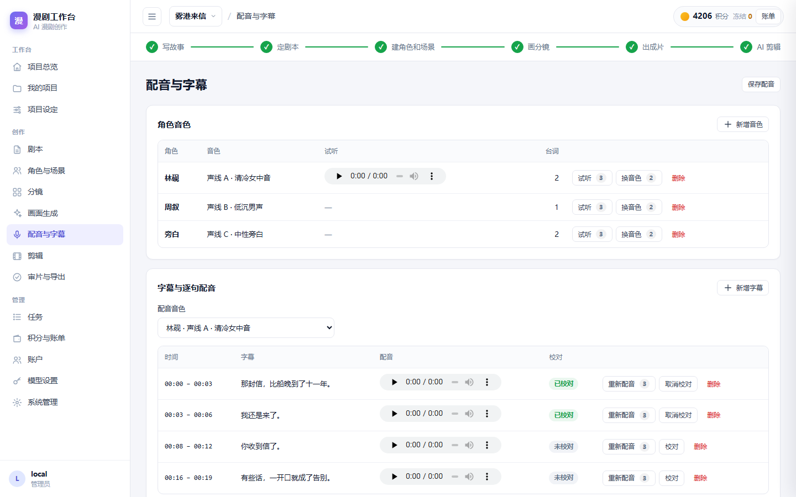
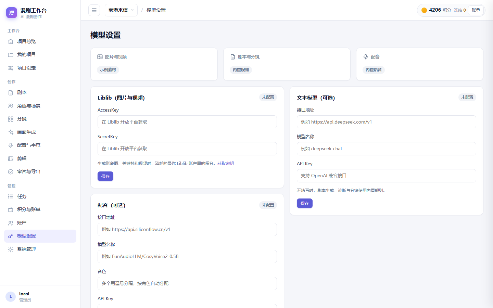

# AI Comic-Drama Studio

[中文](README.md) | English

[](https://github.com/ivanchen225603-sys/AiComicDrama/actions/workflows/ci.yml)  

An AI comic-drama studio that takes a one-line idea all the way to a finished, downloadable short film: script, characters, storyboard, images and video, voice-over and subtitles, editing and export.



| Overview | Storyboard | Generation |
|---|---|---|
|  |  |  |
| **Timeline** | **Voice & subtitles** | **Model settings** |
|  |  |  |

The images and audio in the screenshots are local sample media used when no API key is configured.

## Features

| Stage | What it does |
|---|---|
| Story & script | One-line idea to script, novel adaptation, script review, version diff and freeze |
| Characters & scenes | Extract characters, scenes and props from the script; generate or upload reference images |
| Storyboard | AI shot breakdown, per-shot editing, locking and ordering |
| Generation | Batch keyframes (with candidates), batch image-to-video, history rollback, progress and wait estimates |
| Voice & subtitles | Line-by-line voice-over aligned to the subtitle timeline, background music mixing |
| Edit & export | Timeline, local FFmpeg composition (soft / burned subtitles, multiple resolutions), review checklist, export |
| Operations | Accounts, credits and billing, per-user spending limits, ledger overview and reports, moderation hooks |

**Works with zero keys.** Without any API key, images, video and voice use deterministic local sample media, so the whole pipeline runs end to end and exports a playable sample film.

**Bring your own keys** on the in-app *Model settings* page, no code changes or restart needed:

- **Liblib** (required for real images and video): AccessKey / SecretKey from the [Liblib open platform](https://www.liblib.art/apis). Keyframes and character images use Seedream text-to-image; video uses Kling image-to-video. Usage is billed to your own Liblib account.
- **Text model** (optional): any OpenAI-compatible endpoint (DeepSeek, Qwen, ...). Without it, script generation, review and storyboard use built-in rules.
- **Voice** (optional): any OpenAI-compatible speech endpoint (`/audio/speech`, e.g. OpenAI, SiliconFlow). List several voices separated by commas to give characters different voices.
- *Test connection* only calls free, read-only endpoints. Keys are stored per account on the server and are only ever returned masked.

## Quick start

### Docker

```bash
docker compose up -d --build
```

Open <http://127.0.0.1:8001/>, register an account, then add your keys under *Model settings*. The image ships with FFmpeg and CJK fonts; data lives in the `comic_state` volume.

### Local

Python 3.11–3.13, plus FFmpeg for film composition:

```bash
python -m venv .venv
. .venv/bin/activate          # Windows: .\.venv\Scripts\activate
python -m pip install -r requirements.lock
python -m pip install --no-deps .
python -m comicdrama
```

Open <http://127.0.0.1:8001/> (no sign-in needed from the local machine) and <http://127.0.0.1:8001/docs> for the API. Run one server process per data directory.

## Deploying behind a public domain

| Variable | Purpose |
|---|---|
| `COMIC_REQUIRE_LOGIN=true` | Every visitor must sign in. **Required** behind a reverse proxy, otherwise all visitors share the local account |
| `COMIC_ALLOWED_HOSTS='["your.domain"]'` | Accept requests for your domain (only loopback names are allowed by default) |
| `COMIC_DRAMA_PUBLIC_BASE_URL=https://your.domain` | Needed for video: Liblib fetches first frames through short-lived signed public links |
| `COMIC_CREDIT_ADMINS='["account_id"]'` | Accounts allowed to grant credits and resolve held charges |

See [.env.example](.env.example) for every option.

## Quality checks

Every push runs [GitHub Actions](.github/workflows/ci.yml) on Linux: ruff lint and format, mypy, Python tests (coverage at least 85%, including real FFmpeg composition), frontend tests, and a Docker build-and-start check. Run everything locally:

```bash
python -m ruff check . && python -m ruff format --check . && python -m mypy \n  && python -m pytest --cov=comicdrama --cov-fail-under=85 && node --test tests/test_ui_state.mjs
```

## Development

```bash
python -m pip install -r requirements-dev.lock
python -m pip install --no-deps -e .
python -m pytest
node --test tests/test_ui_state.mjs
python -m ruff check . && python -m ruff format --check . && python -m mypy
```

## License

[Apache License 2.0](LICENSE). Generated content must follow the terms of the model providers you connect and local rules on labelling AI-generated media.
