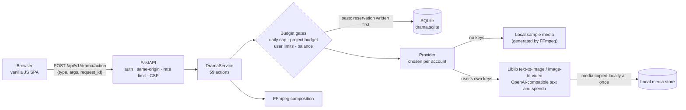
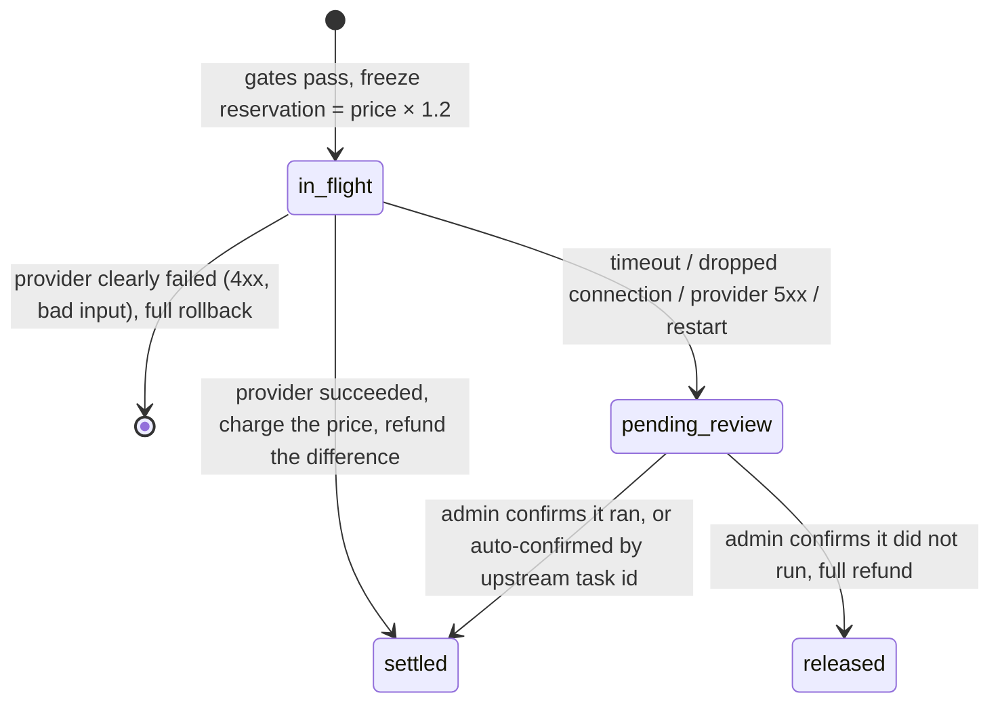

# AI Comic-Drama Studio

[中文](README.md) | English

[](https://github.com/ivanchen225603-sys/AiComicDrama/actions/workflows/ci.yml)  

An AI comic-drama studio that turns a one-line idea into a downloadable short film: script → characters and scenes → storyboard → keyframes and video → voice-over and subtitles → FFmpeg export. **The whole pipeline runs offline with zero keys**; once you add your own Liblib, text-model or voice keys, each stage switches to real generation.


This README focuses on **how the system is engineered and why**. Generation costs real money, so credit reservation and settlement, failures and duplicate requests, concurrency and crash recovery are the heart of the project, more than the number of pages.

## Architecture in 30 seconds



One request, end to end:

1. Every business operation goes to a single endpoint, `POST /api/v1/drama/action`, with an action name, arguments and an idempotency key `request_id`.
2. The server decides who the caller is (session, local or bearer token) and **never trusts an owner sent in the body**.
3. If the same `request_id` already ran, the stored result is replayed; otherwise the action is dispatched.
4. Paid actions pass four checks, then the reserved credits are **written to the database** before any provider call.
5. The provider call happens outside the lock; afterwards the service re-enters the lock and settles, refunds the difference or queues the charge for review.
6. Generated media is copied to local storage immediately, and the film is composed locally with FFmpeg.

## Quick start

```bash
docker compose up -d --build        # or see "Run locally" below
```

Open <http://127.0.0.1:8001/> and register an account. Without keys, every generation uses local sample media.

**Run locally** (Python 3.11–3.13; FFmpeg is needed to compose films):

```bash
python -m venv .venv
. .venv/bin/activate          # Windows: .\.venv\Scripts\activate
python -m pip install -r requirements.lock
python -m pip install --no-deps .
python -m comicdrama
```

No sign-in is needed from the local machine; the API docs are at <http://127.0.0.1:8001/docs>.

| Overview | Storyboard | Generation |
|---|---|---|
|  |  |  |
| **Timeline** | **Voice & subtitles** | **Model settings** |
|  |  |  |

All images and audio in the screenshots are local sample media; every frame is labelled as a sample, not model output.

## Features

| Stage | What it does |
|---|---|
| Story & script | One-line idea to script, novel adaptation, script review, line-by-line version diff and freeze |
| Characters & scenes | Extract characters, scenes and props; generate or upload reference images |
| Storyboard | Automatic shot breakdown, per-shot editing, locking and ordering |
| Generation | Batch keyframes (with candidates), batch image-to-video, history rollback, progress and wait estimates |
| Voice & subtitles | Line-by-line voice-over aligned to the subtitle timeline, background music mixing |
| Edit & export | Timeline, FFmpeg composition (soft or burned subtitles, several resolutions), review checklist, export |
| Operations | Accounts, credits and billing, user spending limits, ledger overview and daily reconciliation reports, moderation hooks |

## Key decisions

| Chosen | Not chosen | Why |
|---|---|---|
| SQLite file, single process | PostgreSQL + Redis, multiple workers | No real concurrent load; a single process makes "read and write the snapshot under a lock" hold by construction, and deployment is one container. The cost is no horizontal scaling (see Known boundaries) |
| One `action` endpoint | A REST resource per entity | All 59 actions share the same auth, idempotency, budget gates, settlement and audit, so no path can skip a check. A REST layer can be added if the API is opened to third parties |
| Write the reservation, then call out | Charge only after the provider succeeds | If the process dies mid-call, an `in_flight` charge is still in the database and goes to review on restart; the other order can spend money upstream with no local record |
| Unknown outcome goes to manual review | Refund every failure automatically | After a timeout the provider may have run the job; refunding and letting the user retry runs it twice and pays twice |
| Sample media only when no key is set, labelled in the frame | Silently fall back to samples when a real call fails | A silent fallback hides real failures and charges for fake results, so a configured key that fails returns an error |
| No platform credits when users bring their own keys | Charge platform prices regardless | The cost already lands on the user's own provider account; charging credits too would bill twice |
| One lock per account, provider call outside it | One global lock | A global lock serialises every user's every action; with per-account locks a 2-second provider call never blocks someone else saving a script |

**Considered and deliberately not built** (no real need, only added complexity):

- **Team permission matrix** (organisation → project → role): per-account data isolation plus an admin allowlist covers single-creator use.
- **Distributed task queue**: no multi-machine deployment; an in-process background loop advances tasks, and all state is in the database, so a restart recovers.
- **Free-form drag-and-drop timeline**: large effort, unrelated to the core flow; the current timeline supports preview and reordering.

## Credit and charge states

Every paid generation creates a charge record (`drama_charge`):



- Keyframe tasks follow their own line, `queued → running → succeeded / failed`, moving to `held` when the outcome is unknown until an admin releases them with a reason.
- **Conservation check**: after every ledger write, "initial credits + top-ups − settled costs − costs of deleted projects = balance + frozen" must hold, or the write is rejected (409) instead of committing a wrong balance.

## Failures, duplicates and concurrency

| Question | How it is handled | Where |
|---|---|---|
| Double clicks, client retries | One `request_id` per account runs once and later calls replay the result; reusing a key for a different action returns 409 | `_idempotent_replay` in `service.py` |
| Process crashes mid-call | On start-up every `in_flight` charge and task moves to review / `held`; frozen credits are kept | `_sweep_in_flight` in `service.py` |
| User retries after a timeout | While a charge for the same project and action awaits review, new submissions are refused | `_charged` in `service.py` |
| Rerolls and retries bypassing budgets | Every reserving entry point shares one gate: daily cap → project budget → user single / total limits → balance, all checked before any provider call | `_afford`, `_check_credit_limits` in `service.py` |
| Two requests editing the same data | One lock per account; read snapshot → modify → write back inside it, call out outside it, then re-read and continue | `action` in `service.py` |
| Provider media links expire | Media is downloaded and stored locally as soon as generation succeeds; pages only use local URLs | `media_store.py` |
| Schema upgrades | `PRAGMA user_version` records the schema version; start-up adds missing columns losslessly and repeatably, and refuses to open a database written by a newer version | `install` in `store.py` |

## Security baseline

- **Keys**: stored per account on the server; APIs return masked views only, never in page data, exports or logs. *Test connection* only calls free, read-only endpoints.
- **Identity**: the server decides the owner and ignores body fields and headers such as `X-Owner`; with `COMIC_REQUIRE_LOGIN=true` every anonymous request gets 401 instead of the local account.
- **Request limits**: same-origin check, Host allowlist, body size limit, per-account rate limit.
- **Pages**: strict CSP (`default-src 'self'`, no inline scripts or styles).
- **Public media links**: video generation needs the provider to fetch the first frame, so the server issues HMAC-signed links valid for 6 hours instead of exposing the media folder.
- **Isolation**: every read and write is filtered by owner; admin actions require the allowlist, and bearer mode has no admins unless configured.

## Tests and quality

- **29 Python test files (532 tests) + 1 frontend test file (33 tests)**, about 12,500 lines of test code, about 92% coverage.
- **Offline and deterministic**: providers are replaced by local fake servers (including real HTTP signature checks); sample media is byte-identical for the same input.
- **Static assertions against drift**: e.g. every online action declared by the frontend must have a server branch, frontend and backend price tables must match, `pricing.py` must not import other business modules, and the moderation module must not import a network client.
- **Regression tests**: every money-related bug that was fixed (rerolls bypassing budgets, double charges after timeouts, conservation failing after project deletion, ...) has a counter-example test.
- **CI**: every push runs ruff, mypy, all tests (coverage at least 85%, including real FFmpeg composition) and frontend tests on Linux, then builds and starts the Docker image. On machines without FFmpeg, tests that need it are skipped with the reason shown.

Run every check locally:

```bash
python -m pip install -r requirements-dev.lock && python -m pip install --no-deps -e .
python -m ruff check . && python -m ruff format --check . && python -m mypy
python -m pytest --cov=comicdrama --cov-fail-under=85
node --test tests/test_ui_state.mjs
```

## Known boundaries

These are deliberate trade-offs, not omissions:

| Boundary | Why it is reasonable for now |
|---|---|
| Images and video use Liblib only | Providers are an interface (`providers/`) with sample, real and per-account hybrid implementations; a second vendor is one more implementation, not built without a real need |
| Single process, SQLite | See Key decisions; run one server process per data directory, since several processes would break the locks |
| The tests contain no real paid calls | Provider calls are covered by local fake servers; real request formats follow the official docs, and a first real integration needs one minimal run with your own key |
| No moderation of image or video content | Only text keyword checks run locally; content moderation needs a dedicated cloud service, so the hook exists but the project does not pretend to inspect pixels |
| The AI-generated label is written to video metadata only | Burning it into the frame cannot be undone and depends on each platform's rules, so it is off by default (marked `TODO(legal)` in code) |
| Payments are an offline simulation | Demo and open-source use do not take real payments; orders, signed callbacks and crediting are implemented and tested |
| Real mode generates one keyframe candidate at a time | The provider's multi-image response has not been verified, so asking for several could bill for several and return one; it is refused rather than charging without delivering. Offline sample mode supports multiple candidates |
| Ambient sound is stored in project settings only | Composition currently mixes voice-over and background music; ambient sound is not wired into composition yet |

## Using real models

Configure them on the in-app *Model settings* page; no code changes or restart:

- **Liblib** (required for real images): AccessKey / SecretKey from the [Liblib open platform](https://www.liblib.art/apis). Character images and keyframes use Seedream text-to-image; video uses Kling image-to-video, billed to your own Liblib account.
- **Text model** (optional): any OpenAI-compatible endpoint (DeepSeek, Qwen, ...). Without it, script, review and storyboard use built-in rules.
- **Voice** (optional): any OpenAI-compatible speech endpoint (`/audio/speech`); list several voices separated by commas to give characters different voices.

## Deploying behind a public domain

| Variable | Purpose |
|---|---|
| `COMIC_REQUIRE_LOGIN=true` | Every visitor must sign in. **Required** behind a reverse proxy |
| `COMIC_ALLOWED_HOSTS='["your.domain"]'` | Accept requests for your domain (only loopback names by default) |
| `COMIC_DRAMA_PUBLIC_BASE_URL=https://your.domain` | Needed for video: the provider fetches first frames from this address |
| `COMIC_CREDIT_ADMINS='["account_id"]'` | Accounts allowed to grant credits and resolve charges under review |

See [.env.example](.env.example) for every option. The Docker image ships with FFmpeg and CJK fonts; data lives in the `comic_state` volume.

## Project layout

```text
comicdrama/
  app.py            App wiring: auth, middleware, routes, static pages
  config.py         Settings (COMIC_ environment variables) and start-up safety checks
  service.py        Action dispatch, budget gates, reservation and settlement, crash recovery
  store.py          SQLite storage, schema version and migration, conservation check
  pricing.py        Price table (same numbers used by the frontend)
  reconcile.py      Ledger overview; reports.py daily reconciliation reports
  credentials.py    User-supplied keys (masked storage, connection checks)
  providers/        Generation: sample media / real models / per-account hybrid
  liblib/           Liblib client (signing, submit, poll, fetch media)
  compose.py        FFmpeg composition; sample_media.py sample media
  web/              Frontend (vanilla JavaScript, no build step)
tests/              Python and frontend tests
```

## License

[Apache License 2.0](LICENSE). Generated content must follow the terms of the model providers you connect and local rules on labelling AI-generated media.
