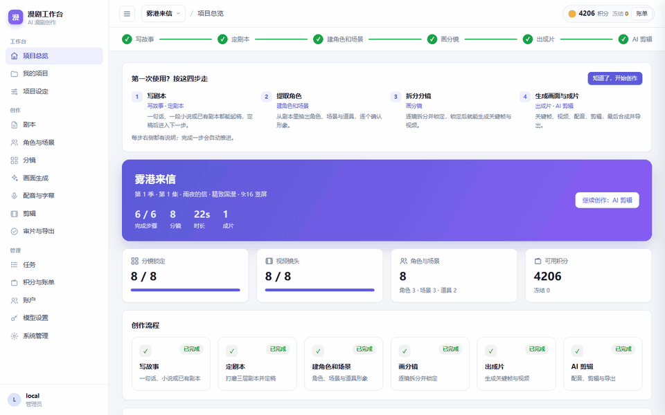
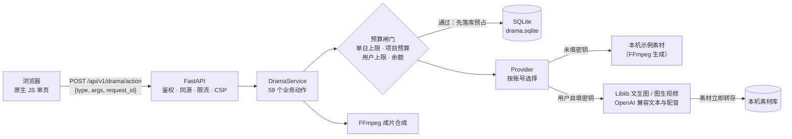
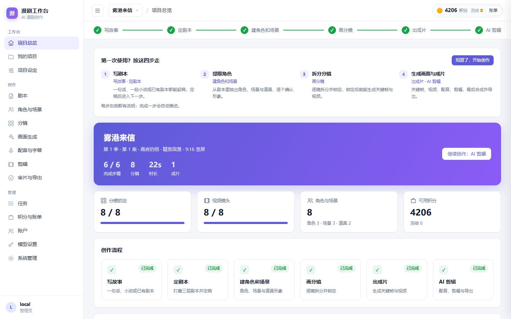
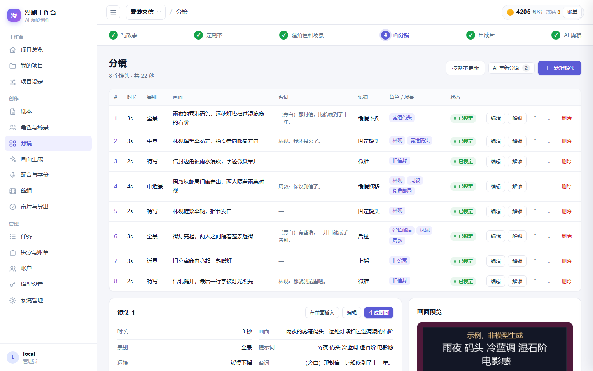
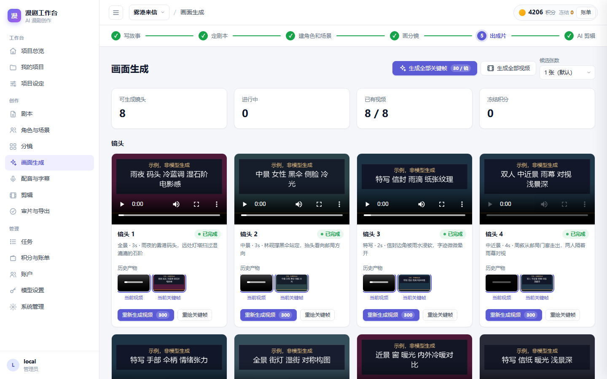
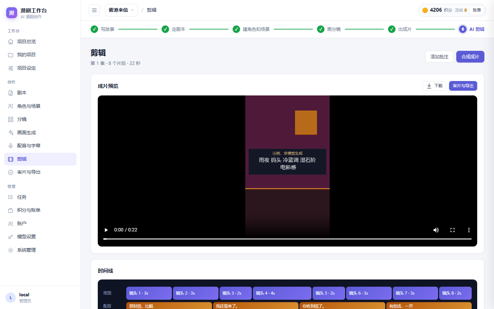
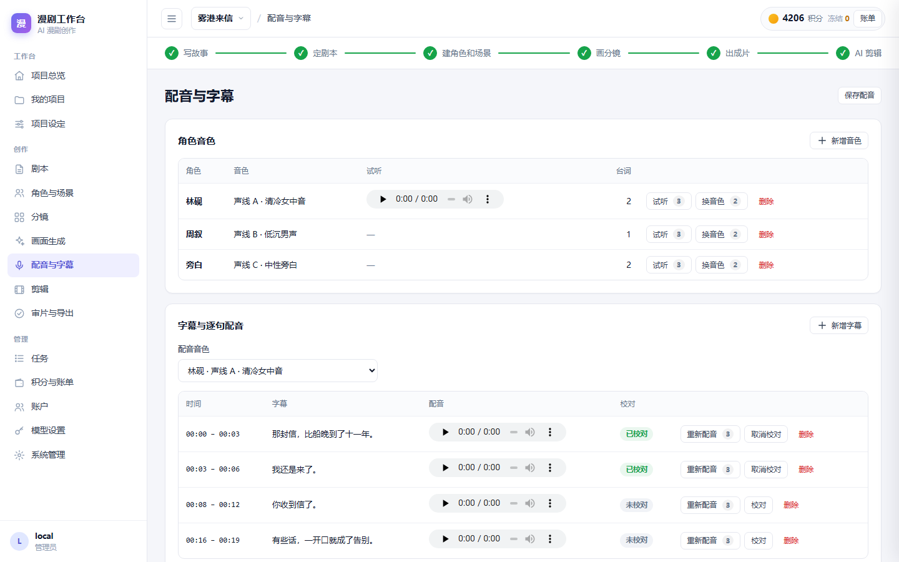
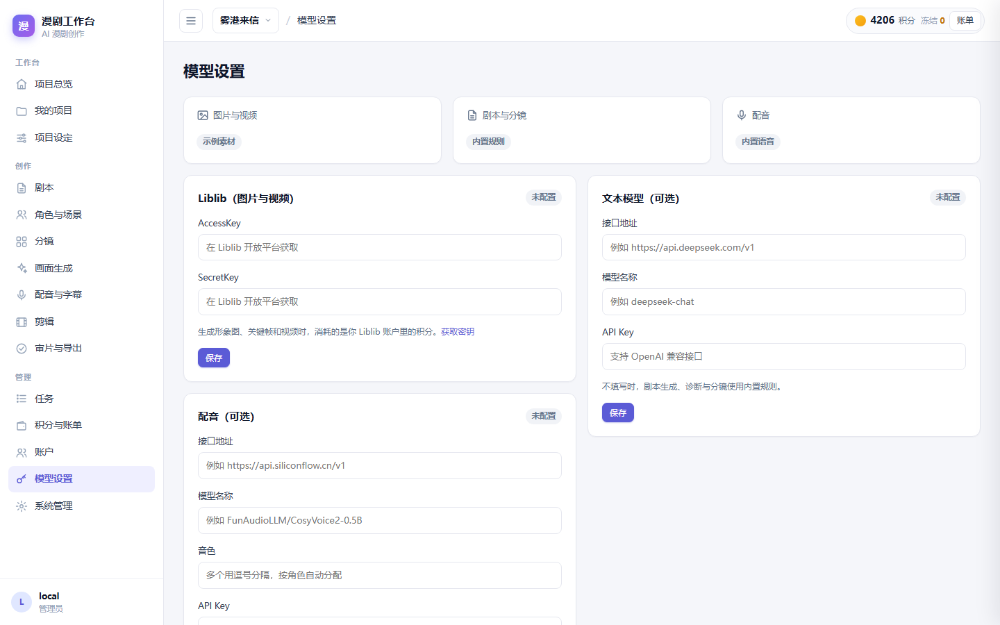
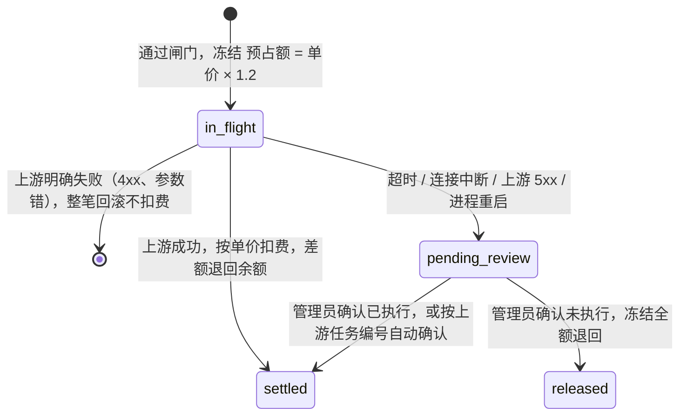

# AI 漫剧工作台

中文 | [English](README.en.md)

[](https://github.com/ivanchen225603-sys/AiComicDrama/actions/workflows/ci.yml)  

从一句话创意到可下载成片的 AI 漫剧工作台：剧本 → 角色与场景 → 分镜 → 关键帧与视频 → 配音字幕 → FFmpeg 合成导出。**不填任何密钥也能离线跑通全流程**；填入自己的 Liblib / 文本模型 / 配音密钥后，对应环节切换为真实生成。



这份 README 重点讲**工程上怎么设计、为什么这样取舍**：生成会花真钱，所以积分预占与结算、失败与重复提交、并发与崩溃恢复是这个项目的核心，而不是页面数量。

## 30 秒看懂架构



一个请求的完整路径：

1. 前端所有业务操作都发到同一个接口 `POST /api/v1/drama/action`，带上动作名、参数和幂等键 `request_id`。
2. 服务端认定身份（会话 / 本机 / 令牌三种模式之一），**从不采信请求体里的 owner**。
3. 同一个 `request_id` 已执行过就直接回放上次结果；否则进入动作分发。
4. 要花钱的动作先过四道检查，再把预占的积分**写进数据库**，然后才出网调模型。
5. 出网在锁外进行；回来后重新进锁，按结果结算、退差或转人工复核。
6. 产物（图片、视频、音频）立即转存到本机，成片由本机 FFmpeg 合成。

## 快速开始

```bash
docker compose up -d --build        # 或见下方「本机运行」
```

浏览器打开 <http://127.0.0.1:8001/>，注册账号后即可使用；不填密钥时所有生成都使用本机示例素材。

**本机运行**（Python 3.11–3.13；合成成片需要 FFmpeg）：

```bash
python -m venv .venv
. .venv/bin/activate          # Windows: .\.venv\Scripts\activate
python -m pip install -r requirements.lock
python -m pip install --no-deps .
python -m comicdrama
```

本机访问无需登录；接口文档在 <http://127.0.0.1:8001/docs>。

| 项目总览 | 分镜 | 画面生成 |
|---|---|---|
|  |  |  |
| **剪辑** | **配音与字幕** | **模型设置** |
|  |  |  |

截图中的画面与配音都是未填写密钥时的本机示例素材，画面内标有「示例，非模型生成」。

## 功能

| 步骤 | 能力 |
|---|---|
| 写故事 / 定剧本 | 一句话生成剧本、小说改编、剧本诊断、版本逐行对比与定稿 |
| 角色与场景 | 从剧本提取角色、场景、道具；生成形象图或上传参考图作为锚点 |
| 分镜 | 自动拆分镜头，逐镜编辑、锁定、排序 |
| 画面生成 | 批量关键帧（支持多候选）、批量图生视频、历史版本回退、进度与预计等待时间 |
| 配音与字幕 | 逐句配音按字幕时间轴对齐，背景音乐混音 |
| 剪辑与导出 | 时间线、FFmpeg 合成（软字幕 / 硬字幕、多分辨率）、审片清单、导出下载 |
| 运营 | 账号、积分与账单、用户自设使用上限、账本概览与按日对账报表、内容审核接口 |

## 关键取舍

| 选择 | 没有选 | 理由 |
|---|---|---|
| SQLite 单文件、单进程 | PostgreSQL + Redis、多 worker | 没有真实并发负载；单进程让「锁内读写快照」天然成立，部署只需一个容器。代价是不能横向扩展，见「已知边界」 |
| 统一的 `action` 接口 | 每个资源一套 REST 接口 | 59 个动作共享同一套鉴权、幂等、预算闸门、结算与审计，不会有哪条路径漏掉检查；前端也只需要一个调用入口。对外开放 API 时再补 REST 资源层 |
| 预占先落库，再出网 | 出网成功后再扣费 | 进程在调用模型期间被杀，数据库里仍有一条 `in_flight` 凭据，重启后转人工复核；反过来做，钱可能已在上游花掉而本地毫无记录 |
| 结果未知就转人工复核 | 失败一律自动退款 | 超时、连接中断时上游可能已经执行；自动退款再让用户重试，会让上游跑两遍、扣两次钱 |
| 没有密钥时明确使用示例素材，画面内标注 | 真实调用失败时悄悄回退到示例 | 回退会让「真实模式」失败被掩盖，用户为假结果付费；所以只有「没填密钥」才走示例，填了密钥失败就报错 |
| 用户自带密钥时不扣平台积分 | 统一按平台价收费 | 费用已经记在用户自己的平台账户上，再扣积分就是重复收费 |
| 每个账号一把锁，出网在锁外 | 一把全局锁 | 全局锁会让所有用户的所有动作串行；锁内只做读写快照，一次 2 秒的模型调用不会挡住别人保存剧本 |

**考虑过、明确不做的方案**（没有对应的真实需求，做了只增加复杂度）：

- **团队权限矩阵**（组织 → 项目 → 角色）：现在是「每个账号只看得到自己的数据」加管理员白名单，足以覆盖单人创作场景。
- **分布式任务队列**：没有多机部署需求；生成任务的推进由进程内的后台循环完成，状态全部在数据库里，重启可恢复。
- **可自由拖拽的剪辑时间线**：工作量大、与核心链路无关；现在的时间线支持预览与调整顺序。

## 积分与生成凭据的状态

每次要花钱的生成都会产生一条凭据（`drama_charge`）：



- 关键帧任务另有一条任务状态线：`queued → running → succeeded / failed`，结果未知时转 `held`，由管理员带原因释放。
- **资金守恒自检**：每次写账本后校验「初始积分 + 充值 − 已结算 − 已删除项目的成本 = 余额 + 冻结」，不成立就拒绝提交（409），不会把错账写进库。

## 失败、重复与并发

| 追问 | 怎么处理 | 代码位置 |
|---|---|---|
| 用户连点、网络重试 | 同一账号同一 `request_id` 只执行一次，再次提交回放上次结果；同一个键换成别的动作返回 409 | `service.py` 的 `_idempotent_replay` |
| 调用中途进程崩溃 | 启动时扫描所有 `in_flight` 凭据与任务，转为待复核 / `held`，冻结保留不丢 | `service.py` 的 `_sweep_in_flight` |
| 超时后用户再点一次 | 同项目同动作存在待复核凭据时拒绝再次提交，直到管理员处理 | `service.py` 的 `_charged` |
| 重抽、重试绕过预算 | 所有要预占的入口共用一套闸门：单日上限 → 项目预算 → 用户自设单次 / 总量上限 → 余额，且都在出网前检查 | `service.py` 的 `_afford`、`_check_credit_limits` |
| 两个请求同时改同一份数据 | 每个账号一把锁，锁内「读快照 → 修改 → 写回」，锁外出网，回来后重新读快照续跑 | `service.py` 的 `action` |
| 上游素材链接过期 | 生成成功后立即下载转存本机，页面只引用本机地址 | `media_store.py` |
| 数据库结构升级 | `PRAGMA user_version` 记录结构版本；启动时无损补列，可重复执行；遇到更高版本的库拒绝启动，避免旧程序写坏新库 | `store.py` 的 `install` |

## 安全基线

- **密钥**：按账号保存在服务端；接口只返回打码视图，不出现在页面数据、导出文件和日志里。「检测连接」只调用不收费的只读接口。
- **身份**：服务端认定 owner，忽略请求体和 `X-Owner` 一类的请求头；公网部署时 `COMIC_REQUIRE_LOGIN=true`，未登录一律 401，不会落到本机账号。
- **请求边界**：同源校验、Host 白名单、请求体大小上限、每账号每分钟限流。
- **页面**：严格 CSP（`default-src 'self'`，不允许内联脚本与样式）。
- **对外素材链接**：视频生成需要上游能拉到首帧图，服务器签发带 6 小时有效期的 HMAC 签名链接，而不是公开整个素材目录。
- **数据隔离**：所有读写都按 owner 过滤；管理类动作只对管理员白名单开放，bearer 模式下不配置就没有管理员。

## 测试与质量

- **29 个 Python 测试文件（532 个用例）+ 1 个前端测试文件（33 个用例）**，测试代码约 1.25 万行，覆盖率约 92%。
- **全部离线、确定性**：上游接口用本地模拟服务（含真实 HTTP 签名校验）替代，示例素材相同输入逐字节相同。
- **静态断言防漂移**：例如前端声明的每个在线动作都必须有服务端分支、前后端定价表必须同值、`pricing.py` 不得依赖其他业务模块、审核模块不得引入网络客户端。
- **回归用例**：每个修过的资金类缺陷（重抽绕过预算、超时后重复扣费、删项目后守恒失败等）都有对应的反例测试。
- **CI**：每次提交在 Linux 上运行 ruff、mypy、全部测试（覆盖率不低于 85%，含真实 FFmpeg 合成）、前端测试，并构建、启动 Docker 镜像检查健康状态。缺少 FFmpeg 的机器上，依赖它的用例会注明原因后跳过。

本地一次跑完全部检查：

```bash
python -m pip install -r requirements-dev.lock && python -m pip install --no-deps -e .
python -m ruff check . && python -m ruff format --check . && python -m mypy
python -m pytest --cov=comicdrama --cov-fail-under=85
node --test tests/test_ui_state.mjs
```

## 已知边界

下面这些是有意识的取舍，不是遗漏：

| 边界 | 为什么现在这样是合理的 |
|---|---|
| 图片和视频只接了 Liblib 一家 | Provider 已经抽象成接口（`providers/`），示例、真实、按账号混合三种实现共用一套调用方式；加第二家只需新增一个实现，没有真实需求前不做 |
| 单进程、SQLite | 见「关键取舍」；一个数据目录只能运行一个服务进程，多进程会导致锁失效 |
| 仓库里的测试不含真实付费调用 | 上游调用全部由本地模拟服务覆盖；真实接口的请求格式按官方文档实现，首次接入需要用自己的密钥做一次最小实测 |
| 图片、视频画面不做内容审核 | 本地只能做文本关键词检查；画面审核必须接专门的云端服务，本项目留了接口但不假装能审 |
| AI 生成标识只写进视频元数据 | 烧进画面不可撤回，需要按发布平台的规定决定位置与样式，所以默认关闭（代码中标注 `TODO(legal)`） |
| 充值是离线模拟流程 | 演示与开源场景不接真实支付；订单、签名回调与入账流程已实现并有测试 |
| 真实模式下关键帧不支持一次生成多张候选 | 上游一次多张的返回格式还没实测过，可能按多张收费却只拿回一张；宁可暂不提供，也不收钱少交付。离线示例模式支持多候选 |
| 环境音（`ambient`）只记录在项目设定里 | 目前合成只混入配音与背景音乐，环境音还没有接入合成链 |

## 接入真实模型

在页面「模型设置」里填写，不需要改代码或重启服务：

- **Liblib（出真实画面必填）**：AccessKey / SecretKey，在 [Liblib 开放平台](https://www.liblib.art/apis) 获取。形象图、关键帧走星流文生图，视频走可灵图生视频，费用记在你自己的 Liblib 账户。
- **文本模型（可选）**：任意 OpenAI 兼容接口（如 DeepSeek、通义千问）。不填时剧本、诊断与分镜使用内置规则。
- **配音（可选）**：任意 OpenAI 兼容的语音合成接口（`/audio/speech`）；多个音色用逗号分隔，按角色自动分配。

## 部署到公网服务器

| 环境变量 | 说明 |
|---|---|
| `COMIC_REQUIRE_LOGIN=true` | 每个访客必须登录自己的账号。经反向代理部署时**必须打开** |
| `COMIC_ALLOWED_HOSTS='["你的域名"]'` | 允许用该域名访问（默认只允许本机地址） |
| `COMIC_DRAMA_PUBLIC_BASE_URL=https://你的域名` | 视频生成需要：上游通过这个地址拉取首帧图片 |
| `COMIC_CREDIT_ADMINS='["账号ID"]'` | 可以加积分、处理待复核凭据的管理员 |

全部配置见 [.env.example](.env.example)。Docker 镜像已包含 FFmpeg 与中文字体，数据保存在 `comic_state` 数据卷。

## 项目结构

```text
comicdrama/
  app.py            应用装配：鉴权、中间件、路由、静态页
  config.py         配置（COMIC_ 前缀环境变量）与启动期安全校验
  service.py        业务动作分发、预算闸门、预占与结算、崩溃恢复
  store.py          SQLite 存储、结构版本与迁移、资金守恒自检
  pricing.py        定价表（前后端共用同一组数字）
  reconcile.py      账本概览；reports.py 按日对账报表
  credentials.py    用户自填密钥（打码保存、连接检测）
  providers/        生成能力：示例素材 / 真实模型 / 按账号混合
  liblib/           Liblib 开放平台客户端（签名、提交、轮询、取回素材）
  compose.py        FFmpeg 成片合成；sample_media.py 示例素材
  web/              前端页面（原生 JavaScript，无构建步骤）
tests/              Python 与前端测试
```

## 许可证

[Apache License 2.0](LICENSE)。生成内容须遵守所接入模型平台的服务条款，以及当地关于 AI 生成内容标识的规定。
